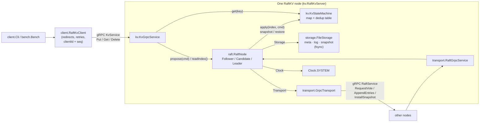
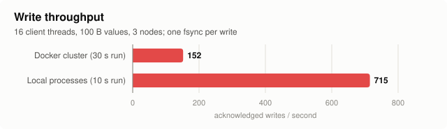
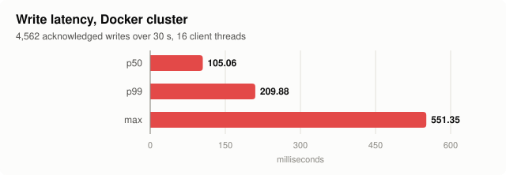
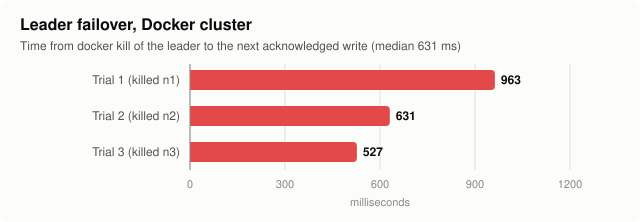

# RaftKV

A small distributed key-value store in Java 21 that implements the
[Raft consensus algorithm](https://raft.github.io/raft.pdf) from scratch: leader election, log
replication, persistence and crash recovery, snapshots with InstallSnapshot, linearizable reads with
ReadIndex, and exactly-once client writes.

It is about 2,000 lines of main code (no Raft library) and is tested by a deterministic simulator
that runs a 5-node cluster through 1,000 randomized fault scenarios in a few seconds.

```
$ docker compose up -d
$ ./gradlew -q cli --args="put language java"
OK
$ ./gradlew -q cli --args="get language"
java
```

## Architecture



`RaftNode` reaches the network, the disk and time **only** through three interfaces: `Transport`,
`Storage`, `Clock`. Production plugs in gRPC, files and the system clock. The tests plug in a simulated
network, in-memory "disks" and a simulated clock, so a whole cluster runs inside one thread,
deterministically, from a seed.

| Package     | What lives there |
|-------------|------------------|
| `raft`      | `RaftNode` (roles, election, replication, commit, apply, ReadIndex, snapshots), `RaftConfig`, `Clock`, `StateMachine` |
| `storage`   | `Storage` interface, `MemoryStorage`, `FileStorage` (append-only log + metadata + snapshot files, fsync) |
| `transport` | `Transport` interface, `GrpcTransport` (outbound), `RaftGrpcService` (inbound) |
| `kv`        | `KvStateMachine`, `Command`, `KvGrpcService` (client API), `RaftKvServer`, `Main` |
| `client`    | `RaftKvClient` (leader redirects, retries, dedup ids), `Cli` |
| `bench`     | `Bench` load generator and failover timer |

## Running it

Requirements: JDK 21 or newer, and Docker for the cluster. Gradle comes with the wrapper.

### 3-node cluster with Docker

```bash
docker compose up -d --build       # nodes n1, n2, n3 on localhost:9001, 9002, 9003
./gradlew -q cli --args="put user:1 alice"
./gradlew -q cli --args="get user:1"
./gradlew -q cli --args="delete user:1"
docker compose logs -f             # watch elections: "became leader for term 3"
docker kill raftkv-n1              # kill a node; the CLI keeps working while 2 of 3 are up
docker compose down -v             # stop and wipe the data volumes
```

The CLI talks to `localhost:9001,9002,9003` by default; override with `--cluster h:p,h:p` or
`RAFTKV_CLUSTER`. If it reaches a follower, the follower replies `NOT_LEADER` with the leader's
address and the client retries there.

### Without Docker

```bash
./gradlew installDist     # build/install/raftkv/bin/raftkv (raftkv.bat on Windows) + lib/
P=n1=localhost:9001,n2=localhost:9002,n3=localhost:9003
build/install/raftkv/bin/raftkv --id n1 --port 9001 --data data/n1 --peers $P &
build/install/raftkv/bin/raftkv --id n2 --port 9002 --data data/n2 --peers $P &
build/install/raftkv/bin/raftkv --id n3 --port 9003 --data data/n3 --peers $P &
./gradlew -q cli --args="put hello world"
```

Flags (or env vars `RAFTKV_ID`, `RAFTKV_PORT`, …): `--id`, `--port`, `--data`, `--peers`,
`--client-addrs` (addresses to redirect clients to, if they differ from the peer addresses, as in
Docker), `--snapshot-every` (default 10,000 entries).

## Tests

```bash
./gradlew build                                  # compile + all tests (about 10 s)
./gradlew test --tests '*RandomizedSimulationTest*' -Dseed=417   # replay one simulation seed
./gradlew test --tests '*RandomizedSimulationTest*' -Dseeds=5000 # run more seeds
./gradlew test --tests '*RandomizedSimulationTest*' -Dverbose=true  # per-seed stats
```

| Test | What it checks |
|------|----------------|
| `sim.RandomizedSimulationTest` | 1,000 seeds × a 5-node cluster for 5 s of simulated time with 3 writing clients, random partitions, 0–30 % message loss, message reordering, and node crash/restarts. Then heals everything and asserts: at most one leader per term (checked after **every** event); a node never applies a different command at an index than any other node did; applied indices only increase; committed log entries are never changed; no node ends behind what was applied before healing; all replicas end with identical state; every acknowledged write is readable through a ReadIndex read. A failure prints `rerun with -Dseed=N`. |
| `raft.CommitRuleTest` | Replays Figure 8 of the paper message by message: a leader must not commit an entry from an earlier term by counting replicas (§5.4.2). |
| `sim.ElectionTest` | One leader is elected and kept; a new one is elected after the leader dies; an isolated old leader steps down when it rejoins. |
| `sim.RestartTest` | Kills and restarts nodes (half the time the leader) during writes, using the real `FileStorage`: a crash closes the files and a restart recovers from disk. No acknowledged write is lost. |
| `sim.SnapshotTest` | A follower is dead while the leader writes past several snapshots; on restart it catches up through InstallSnapshot and ends with an identical state. |
| `kv.GrpcClusterTest` | Three real nodes on localhost over gRPC with file storage: put/get/delete, redirects, leader kill and failover, restart of the old leader from disk. |
| `storage.FileStorageTest` | Term/vote/log survive reopen; durable truncation; snapshot compaction; a torn write at the end of the log is discarded. |
| `kv.KvStateMachineTest` | Put/delete; a retried write is applied once; the dedup table survives a snapshot. |

**Does the simulation actually catch bugs?** I checked by breaking the code on purpose:

- Removing the election restriction (§5.4.1) makes the simulation fail on seed 1
  (`leader tried to overwrite committed entry 202`).
- Removing the "only commit current-term entries" rule (§5.4.2) is *not* caught by the random
  simulation in 1,000 seeds, because it needs the exact Figure 8 interleaving. That's why
  `CommitRuleTest` exists, and it fails when the rule is removed.

## Benchmark

`./gradlew bench` runs against the Docker cluster: 16 client threads write 100-byte values for 30
seconds, then it kills the leader container three times and measures how long until a write succeeds
again. One run on a Ryzen 5 5600H laptop with Docker Desktop (WSL2) printed:

| writes/sec | p50 | p99 | failover (median of 3) |
|-----------:|----:|----:|-----------------------:|
| 152 | 105.06 ms | 209.88 ms | 631 ms |







Throughput is bound by fsync: one synced write inside Docker Desktop's VM took about 6.7 ms on that
machine, and the leader fsyncs every write separately (no group commit). Full output, the fsync
measurement, and a no-Docker run are in [BENCHMARKS.md](BENCHMARKS.md).

## Design decisions

- **One lock per node, tick-driven.** Every public `RaftNode` method is `synchronized`, and time only
  advances through `tick()` (every 10 ms in production, every 5 ms of simulated time in tests). There
  are no internal threads or timers, which is what makes the simulation deterministic.
- **Fire-and-forget transport.** `Transport` calls never block and may silently lose the request or
  reply. Raft already tolerates that; retries happen on the next heartbeat.
- **Proto messages inside `RaftNode`.** The Raft RPCs use the generated protobuf classes directly
  instead of a parallel set of Java records. That's less code, at the cost of coupling `raft` to
  the generated types.
- **No-op on election (§8).** A new leader appends an empty entry. This commits earlier-term entries
  quickly and gives ReadIndex a committed entry from the current term.
- **One RPC in flight per follower, heartbeats always go out.** While an AppendEntries is
  outstanding, new writes queue up and go out together in the next batch (up to 512 entries).
  Heartbeats are sent regardless and double as retries.
- **Fast log backtracking.** A rejecting follower returns `conflictIndex` (the first index of the
  conflicting term, or its log length), so the leader skips a whole term per round trip.
- **ReadIndex with heartbeat rounds.** Each read records `commitIndex` and a round number; the
  leader sends a heartbeat round; the read is served once a majority has answered that round *in the
  current term* and `lastApplied ≥ readIndex`.
- **Exactly-once writes.** Each client has a UUID and a sequence number. `KvStateMachine` remembers the
  highest sequence applied per client and skips duplicates. The table is part of the snapshot.
- **File format.** `meta` (term + vote) and `snapshot` are replaced atomically (write temp file, fsync,
  rename). `log` is append-only with `[len][term][index][bytes][crc32]` records. Truncation cuts the
  file at a remembered offset. Compaction rewrites the log file. On startup a torn or corrupt tail is
  cut off.
- **Timeouts:** election 300–600 ms, heartbeat 50 ms (the simulation uses 150–300 ms).
- **Java 21 bytecode**, built with any JDK ≥ 21 (`options.release = 21`); the Docker image uses
  Temurin 21.

## Known limitations

- **No membership changes.** The cluster is fixed at startup (no joint consensus or single-server changes).
- **No pre-vote.** A partitioned node that rejoins with a higher term forces the leader to step down
  and causes an unnecessary election.
- **Whole-snapshot transfer.** InstallSnapshot sends the entire snapshot in one message (no chunking),
  so snapshots must fit comfortably in memory and in one gRPC message (4 MB default limit).
- **Snapshots are taken synchronously** under the node lock, which pauses the node briefly.
- **No leader lease / check-quorum.** A leader cut off from the majority keeps believing it is
  leader until it hears a higher term. That's safe (its writes never commit and its ReadIndex
  reads never confirm), but those requests just time out.
- **One fsync per append**, with no group commit across concurrent writes on the leader. Throughput
  is bounded by disk sync latency.
- **No directory fsync after rename**, so the atomic replace of `meta`/`snapshot` relies on the
  filesystem's rename durability.
- **No auth or TLS**; plaintext gRPC.
